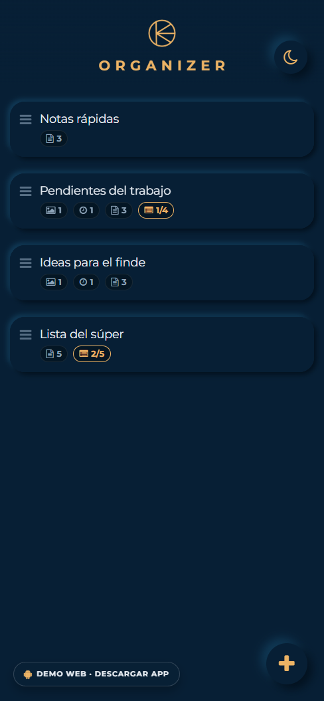
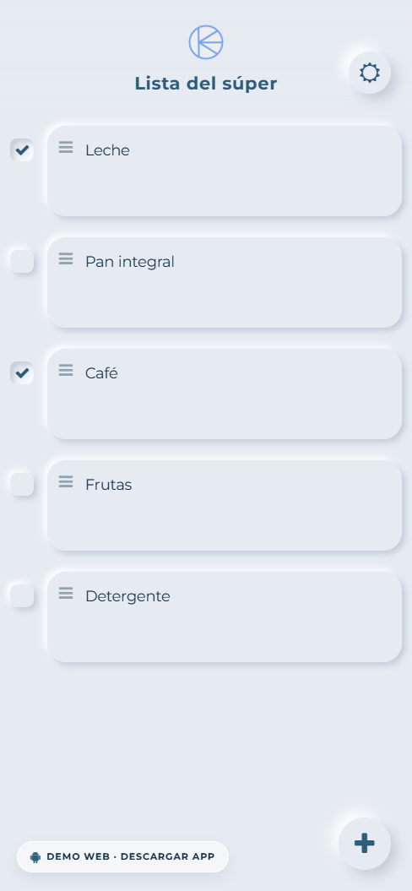

# Organizer

App de recordatorios con listas, notas de texto, imágenes, audio y alarmas.
Funciona offline: todo se guarda en el dispositivo con AsyncStorage + Redux Persist.

- **Expo SDK 58** · React Native 0.88 · React 19 · TypeScript 6
- Navegación: `@react-navigation/stack` v7
- Estado: Redux 5 + `react-redux` 9 + `redux-persist`
- Listas reordenables: `react-native-reorderable-list` (Reanimated 4)
- Audio: `expo-audio` · Cámara: `expo-camera` (`CameraView`) · Notificaciones: `expo-notifications`

## Descargar

[](https://github.com/lore64210/reminder/releases/latest)
[](https://expo.dev)
[](https://www.typescriptlang.org/)

[⬇️ Descargar APK](https://github.com/lore64210/reminder/releases/latest) · [🖥️ Demo web](https://lore64210.github.io/reminder/demo/) · [🌐 Portfolio](https://lore64210.github.io/reminder/) · [Instrucciones de instalación](docs/install.md)

Se distribuye como APK firmado desde [GitHub Releases](https://github.com/lore64210/reminder/releases). Funciona offline y no requiere cuenta.

> La primera versión se publica en cuanto se configure EAS. Ver [`docs/releasing.md`](docs/releasing.md).

### Demo web

La demo corre en el navegador con datos de ejemplo. Las notificaciones no existen en web y la cámara, el audio y la persistencia de archivos están limitados; para la experiencia completa, instalá el APK.

<p align="center">
  
  
</p>

## Requisitos

| Herramienta | Versión |
|---|---|
| Node.js | **24 LTS** (SDK 58 exige `^22.13`, `^24.3` o `>=26`) |
| npm | 10+ (viene con Node) |
| Expo Go | última versión, desde Play Store / App Store |

El proyecto incluye `.nvmrc`. Si usás nvm-windows:

```powershell
nvm use 24.11.1
node -v   # v24.11.1
```

> Si `nvm use` falla por permisos, abrí la terminal como administrador.

## Instalación

```powershell
npm ci
npx expo-doctor   # debe pasar 20/20
```

## Desarrollo

```powershell
npm start          # Metro + QR
npm run start:clear # igual, limpiando caché
npm run android    # abre en un emulador/dispositivo Android (requiere adb)
npm run web        # versión web (algunas features nativas no aplican)
npm run typecheck  # tsc --noEmit
```

Con **Expo Go** (camino recomendado, no requiere Android Studio):

1. Instalá Expo Go en el teléfono.
2. Conectá el teléfono y la PC a la **misma red Wi-Fi**.
3. `npm start` y escaneá el QR (Android: desde Expo Go; iOS: con la cámara).
4. Si no conecta, permití `node.exe` en el Firewall de Windows (puerto 8081).

### Limitaciones de Expo Go

- Las notificaciones **locales** (alarmas) funcionan.
- El **push remoto** no está soportado en Android desde SDK 53 (no lo usamos).
- Para builds nativos (EAS o `expo run:android`) hace falta Android Studio + JDK 17/21 y `ANDROID_HOME`.

## Estructura

```
index.ts                  registerRootComponent
App.tsx                   providers, splash, fuentes, notificaciones
src/
  components/
    atoms/                IconButton, Checkbox, DialogButton, Glass*
    molecules/            Header, Layout, ItemList, HomeItem, ModalAudio, ModalTitle
    organisms/            HomeScreen, ReminderScreen, CameraScreen, GalleryModal
    templates/            StackNavigator
  config/
    i18n.ts               i18n-js v4 + expo-localization
    translations.ts       textos es/en
    theme.ts              temas claro/oscuro
    types.ts              modelos y tipos del store
    redux/                actions, reducers, store, hooks tipados
  hooks/                  useKeyboardOffset
  providers/              diálogos, overlays, blur y altura del header
  services/
    notifications.ts      permisos, canal Android, agendar/cancelar alarmas
  utils/                  fechas, archivos, migración de medios, reorder, uuid
```

## Notas de la actualización (SDK 44 → 58)

- `expo-av` fue eliminado del SDK → migrado a `expo-audio` (grabación y reproducción).
- `expo-camera` cambió a `CameraView` + `useCameraPermissions`.
- `expo-barcode-scanner` fue eliminado → el escaneo usa `expo-camera`.
- `expo-app-loading` fue eliminado → `expo-splash-screen`.
- `react-native-drax` (sin mantenimiento y sin soporte Fabric) → `react-native-reorderable-list`.
  Se perdió el gesto "arrastrar al tacho": ahora se reordena con long-press y se borra con el botón de tacho.
- `i18n-js` v4 (`I18n` class + `store`) y `expo-localization` (`getLocales()`).
- `redux` 5 / `react-redux` 9: selectores y dispatch tipados, sin `@ts-ignore`.
- Alarmas: se guardan como ISO UTC real (antes había un ajuste manual de zona horaria que se rompía con el horario de verano).
- Persistencia: una sola clave (`persist:root`) con `version: 2` y migración.

## Pendientes conocidos

- El selector de fecha/hora usa el diálogo nativo de Android; en iOS se muestra inline (falta envolverlo en un modal propio).
- Sin tests automatizados ni ESLint todavía.

## Publicación

- El APK se compila con el perfil `release-apk` de EAS y se publica en GitHub Releases al pushear un tag `v*`.
- Guía paso a paso: [`docs/releasing.md`](docs/releasing.md).
- Instalación en Android: [`docs/install.md`](docs/install.md).
- Privacidad: [`PRIVACY.md`](PRIVACY.md).
- Plan de Play Store (referencia): [`docs/playstore-plan.md`](docs/playstore-plan.md).

## Licencia

Código publicado con fines de portfolio. Todos los derechos reservados. Si querés reutilizarlo, abrí un issue.
